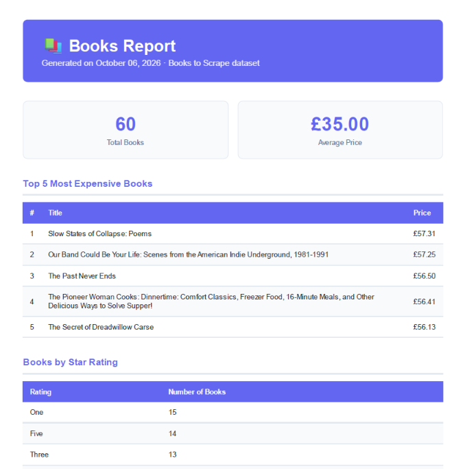

# Week 07b — PDF Report Generator

A FastAPI pipeline that queries book data, renders it into a PDF report,
and serves it by link. Built using the books dataset from Week 5.

## Dataset

Option B — 60 books scraped from books.toscrape.com in Week 5.
Stored in SQLite (`report.db`).

## How to run

```bash
cd week-07b
python -m venv venv
venv\Scripts\activate
pip install -r requirements.txt
playwright install chromium
python seed.py
uvicorn main:app --reload
```

## Generate and download a report

```bash
# Generate
curl -i -X POST http://localhost:8000/reports

# Download
curl -o report.pdf http://localhost:8000/reports/1/file
```

## Aggregation SQL

```sql
-- Total books
SELECT COUNT(*) FROM books;

-- Average price
SELECT ROUND(AVG(price), 2) FROM books;

-- Top 5 most expensive
SELECT title, price FROM books ORDER BY price DESC LIMIT 5;

-- Books per rating
SELECT rating, COUNT(*) FROM books GROUP BY rating ORDER BY count DESC;
```

## API Endpoints

| Method | Endpoint | Description |
|--------|----------|-------------|
| GET | /health | Health check |
| POST | /reports | Generate report (201) or return existing (200) |
| GET | /reports/{id} | Get report record |
| GET | /reports/{id}/file | Download PDF |

## Idempotency

Two rapid POSTs on the same day return the same id and produce exactly
one PDF file. This protects against double-clicks and duplicate requests.

Real-world example: without this check, a double-clicked "Generate Invoice"
button could email a customer the same invoice twice — or charge them twice.

Use `?force=true` to generate a fresh report regardless.

## Stage 4 note

The POST endpoint takes a few seconds because it runs the full pipeline
synchronously inside the request. I would move generation to a background
job when reports get larger or when many users request them simultaneously.

## PDF Screenshot

