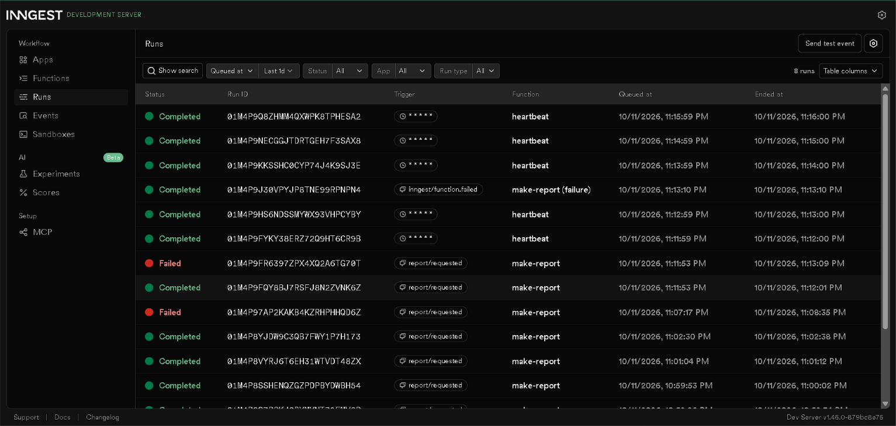

# Week 7c: Your first background job (FastAPI + Inngest)

A small API where the slow work (an 8-second report) runs in a background job.
The API answers instantly with 202, a status endpoint reports progress,
and one cron job runs on the clock alone.

## How to run

Terminal 1 (API):
```powershell
pip install -r requirements.txt
uvicorn main:app --reload
```

Terminal 2 (Inngest Dev Server):
```powershell
npx inngest-cli@latest dev -u http://127.0.0.1:8000/api/inngest
```

Dashboard: http://127.0.0.1:8288

## Endpoints and functions

| Name | Type | What it does |
|------|------|--------------|
| GET /health | endpoint | returns {"status":"ok"} |
| POST /reports | endpoint | validates topic (400 if missing), saves pending report, sends event, returns 202 |
| GET /reports/{id} | endpoint | returns the report (pending, done or failed); unknown id gives 404 |
| say-hello | function (event test/hello) | sleeps 5s, returns a greeting |
| make-report | function (event report/requested) | sleeps 8s, then builds the report; retries=2 |
| heartbeat | function (cron * * * * *) | logs how many reports are pending, done and failed |

## Proof: 202 then the polls

(paste your 202 response with Time: 0.219725s, then the pending poll and the done poll)

## Stage 3: retries vs bad input

A retry fixes a wrong moment (a network drop), but bad input like a missing topic will fail every time, so it is rejected at the door with a 400 and no job is created.

## Stage 4: cron

- Every day at 08:00: `0 8 * * *`
- Every Sunday at 22:00: `0 22 * * 0`

## Dashboard screenshot

